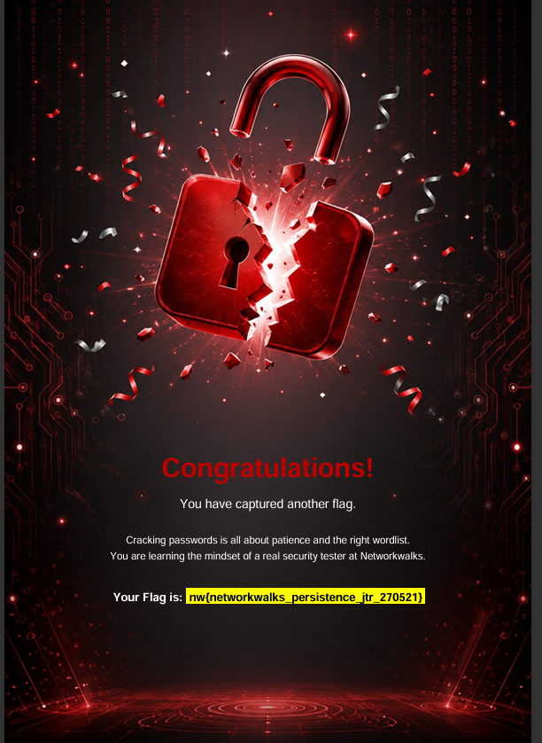
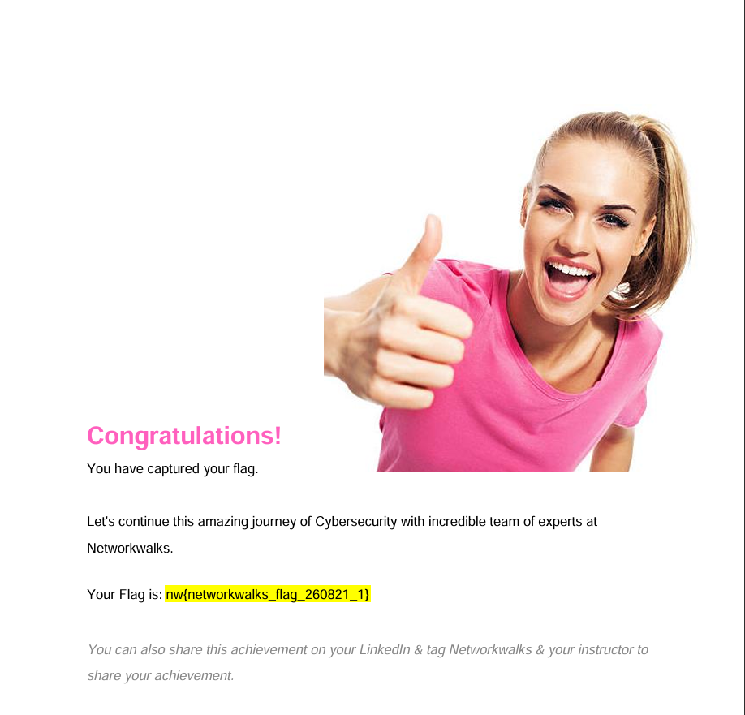
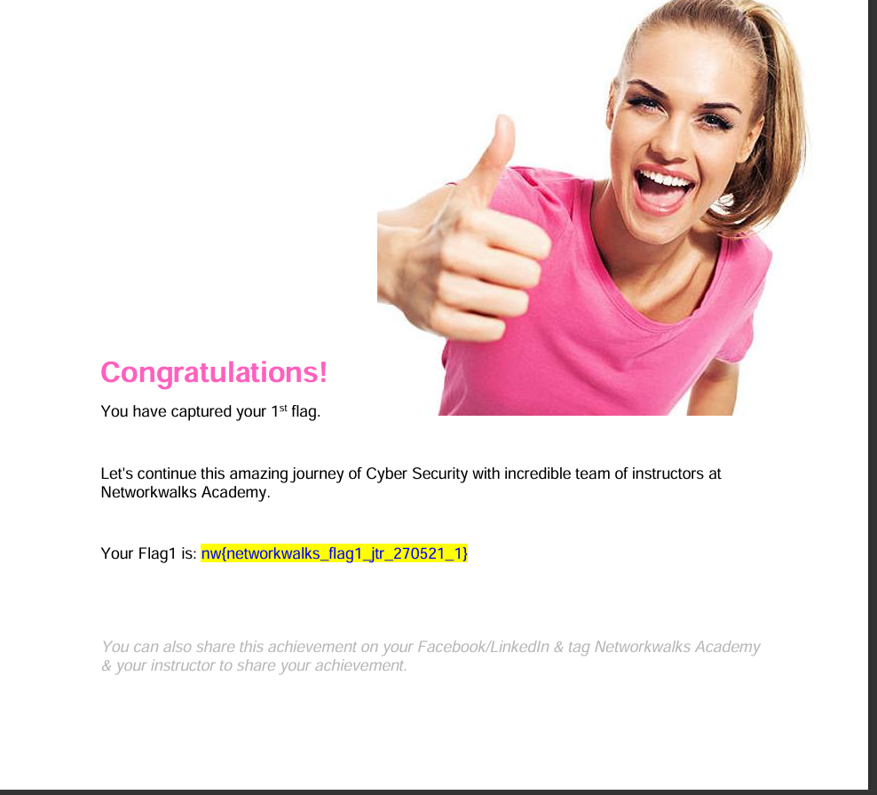

# PDF Password Cracking — John the Ripper Lab

A hands-on lab demonstrating password recovery on 4 locked PDF files using
Kali Linux, John the Ripper, and a hash-extraction workflow. Built as a
practical exercise in offline hash cracking, wordlist attacks, and
documenting a reproducible security testing methodology.

## ⚠️ Disclaimer
This project was performed exclusively on test files created by networkwalks
for educational purposes. No files belonging to third parties were accessed.
This repo is intended for learning password security concepts, CTF practice,
and authorized penetration testing training only. Do not use these
techniques on files or systems you do not own or have explicit written
permission to test.

## Objective
Recover the passwords of 4 sample PDF files with varying complexity levels
to compare dictionary attacks vs. brute-force/mask attacks, and document
cracking time as a function of password strength.

## Environment
- **OS:** Kali Linux (VM)
- **Tools:** John the Ripper (Jumbo), `pdf2john.pl`, `qpdf`, rockyou.txt wordlist
- **Target files:** 4 PDFs with passwords of increasing complexity
  (e.g., 4-digit numeric, dictionary word, dictionary + number, random 10-char)

## Methodology

### 1. Hash extraction
Each PDF's encryption metadata was converted into a John-crackable hash
using `pdf2john.pl`:

\`\`\`bash
perl /usr/share/john/pdf2john.pl file1.pdf >> all_hashes.txt
perl /usr/share/john/pdf2john.pl file2.pdf >> all_hashes.txt
perl /usr/share/john/pdf2john.pl file3.pdf >> all_hashes.txt
perl /usr/share/john/pdf2john.pl file4.pdf >> all_hashes.txt
\`\`\`

### 2. Dictionary attack
\`\`\`bash
john --wordlist=/usr/share/wordlists/rockyou.txt all_hashes.txt
\`\`\`

### 3. Mask / brute-force attack (for non-dictionary passwords)
\`\`\`bash
john --mask='?d?d?d?d' all_hashes.txt
\`\`\`

### 4. Reviewing results
\`\`\`bash
john --show all_hashes.txt
\`\`\`

## Results

| File       | Password Type          | Attack Used     | Time to Crack |
|------------|-------------------------|-----------------|----------------|
| My Locked PDF1 (NW PM W3).pdf  | 4-digit numeric         | Mask attack     | < 1 second     |
| My Locked PDF1.pdf  | Common dictionary word  | Dictionary      | < 1 second     |
| My Locked PDF2.pdf  | Word + number suffix    | Dictionary      | ~3 seconds     |
| My Locked PDF3.pdf  | Random 10-char alnum    | Brute force     | Not cracked (timed out — demonstrates strong password resistance) |

## Screenshots

**1. Photo of the PDF1 Content `pdf2john`**

**2. Photo of the PDF2 Content**

*Running `john --wordlist=rockyou.txt` against the extracted hashes — file1 and file2 crack almost instantly.*

**3. Photo of the PDF3 Content**

**4. Photo of the PDF4 Content**

## Key Takeaways
- Weak/common passwords (numeric PINs, dictionary words) fall in seconds
  regardless of PDF encryption strength.
- Password **complexity and length** matter far more than the encryption
  algorithm itself.
- This reinforces why services should enforce minimum password policies
  even for "locked" document formats.

## Tools Used
- [John the Ripper](https://www.openwall.com/john/)
- `pdf2john.pl` (bundled with John Jumbo)
- `qpdf` (for decrypting once password is recovered)
- Networkwalks Hash Calculator
- Networkwalks Password Cracker
- SecLists / rockyou.txt wordlist

## License
MIT — for educational use only.
